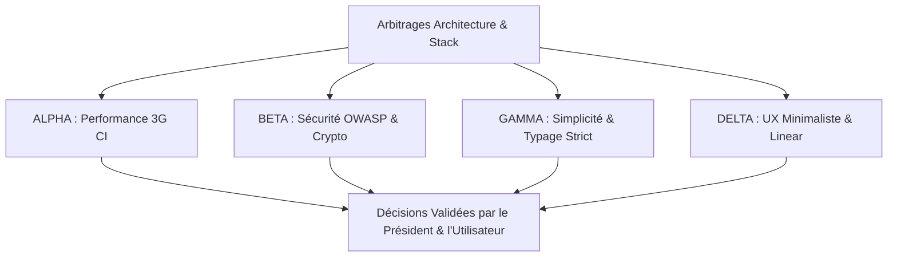

# Décisions Architecturales — Protocole LLM Council

Délibération multi-perspectives (**Alpha** : Performance & Réseau 3G Côte d'Ivoire, **Beta** : Sécurité OWASP, **Gamma** : Simplicité & Typage Strict, **Delta** : UX Terrain & Minimalisme) appliquée pour trancher les choix structurants du portfolio de **Manu KRA** (Communication & Économie).

---

## Arbitrage 1 — Typage Frontend (« Pas de `any` » + « Stack JavaScript »)

| Proposition | Faisabilité | Sécurité | Simplicité | Note (/30) | Critique principale |
| :--- | :---: | :---: | :---: | :---: | :--- |
| **A — JS pur + JSDoc** | 8 | 5 | 8 | 21 | N'empêche pas les `any` implicites au build et affaiblit les contrats Front/Back. |
| **B — TypeScript strict (`no-explicit-any`) + Zod** | 10 | 9 | 9 | **28** | Empêche `any` à la compilation (`tsc`) et au lint, natif avec Next.js/Neon/shadcn. |

**Verdict retenu :** **TypeScript strict (`strict: true`, `@typescript-eslint/no-explicit-any: "error"`)** + **Zod** pour valider toutes les entrées front et back.

---

## Arbitrage 2 — Système d'Icônes (`minimalist-skill` vs `shadcn/ui`)

| Proposition | Faisabilité | Sécurité | Simplicité | Note (/30) | Critique principale |
| :--- | :---: | :---: | :---: | :---: | :--- |
| **A — Lucide (défaut shadcn)** | 10 | 9 | 9 | 28 (rejeté) | Viole la règle explicite de `minimalist-skill` qui interdit Lucide pour éviter l'esthétique générique. |
| **B — Phosphor Icons (`@phosphor-icons/react`) + Radix UI Icons** | 9 | 9 | 9 | **27** | Respecte 100 % `minimalist-skill`, rendu technique plus affirmé, configurable directement dans `components.json` / wrappers `shadcn/ui`. |

**Verdict retenu :** **Interdiction de `lucide-react`**. Utilisation exclusive de **`@phosphor-icons/react`** (poids cohérent `bold` / `regular`, `weight` standardisé) et de **`@radix-ui/react-icons`** si besoin pour les primitives UI, strictement monochromes.

---

## Arbitrage 3 — Authentification Masquée, Commentaires Sans Compte & Cryptographie

| Proposition | Faisabilité | Sécurité | Simplicité | Note (/30) | Critique principale |
| :--- | :---: | :---: | :---: | :---: | :--- |
| **A — Neon Auth Managed avec comptes publics** | 9 | 8 | 8 | 25 | Expose des routes d'inscription superflues et ne fournit pas le chiffrement `AES-256-GCM` au niveau applicatif. |
| **B — Auth Admin Masquée (`bcrypt` + Sessions `SHA-256`) + Commentaires Visiteurs Sans Compte** | 9 | 10 | 9 | **28** | Aucun compte visiteur, route admin cachée et protégée, conformité exacte avec `bcrypt`, `AES-256-GCM` et hachage `SHA-256`. |

**Verdict retenu :**
- **Admin unique masqué** : route d'accès non liée en public (slug secret via variable d'environnement, ex. `/acces-studio`), mot de passe hashé `bcryptjs` (cost 12), session cookie `HttpOnly; Secure; SameSite=Strict` dont le jeton est stocké hashé `SHA-256` dans Neon Postgres.
- **Chiffrement au repos** : `AES-256-GCM` (`node:crypto`) pour téléphone, email de secours et métadonnées sensibles dans `admin_profiles`.
- **Commentaires d'articles** : ouverts **sans création de compte**, validés par Zod, nettoyés anti-XSS, protégés par rate-limiting + champ honeypot, publiés après modération (ou workflow configurable en CMS).

---

## Arbitrage 4 — Médias (Multi-photos, Vidéos & Logos) sur Connexion Faible Côte d'Ivoire (3G)

| Proposition | Faisabilité | Sécurité | Simplicité | Note (/30) | Critique principale |
| :--- | :---: | :---: | :---: | :---: | :--- |
| **A — Stockage local repo ou Base64 en DB** | 5 | 7 | 7 | 19 | Alourdit le repo, ralentit les pages, fait exploser l'egress Postgres. |
| **B — Neon Object Storage (`public_read` + CDN Edge) + WebP/AVIF + LQIP + Vidéo `preload="none"`** | 9 | 9 | 9 | **27** | Branches synchronisées avec Neon Postgres, cache CDN immutable 1 an, consommation data minimale en 3G. |

**Verdict retenu :** **Neon Object Storage** avec clés versionnées immutables, conversion WebP/AVIF multi-tailles, placeholder flouté LQIP (< 1 Ko) inline, et lecture vidéo déclenchée uniquement à la demande sur un poster WebP léger.

---

## Arbitrage 5 — Section Projets Scroll-Pinned sur Page d'Accueil Courte

| Proposition | Faisabilité | Sécurité | Simplicité | Note (/30) | Critique principale |
| :--- | :---: | :---: | :---: | :---: | :--- |
| **A — Grille verticale classique** | 10 | 10 | 9 | 29 (hors brief) | Allonge trop la page d'accueil. |
| **B — Stage `position: sticky` Scroll-Driven (strictement max 3 projets)** | 9 | 10 | 8 | **27** | Permet au visiteur de scroller tout en restant sur la même section pour parcourir les 3 projets phares, avec dégradation propre mobile & `prefers-reduced-motion`. |

**Verdict retenu :** Section Projets **épinglée au scroll (`position: sticky`)** limitée à **3 projets maximum** sur la page d'accueil, suivie d'un bouton **« Voir plus de projets »** vers `/projets`.

