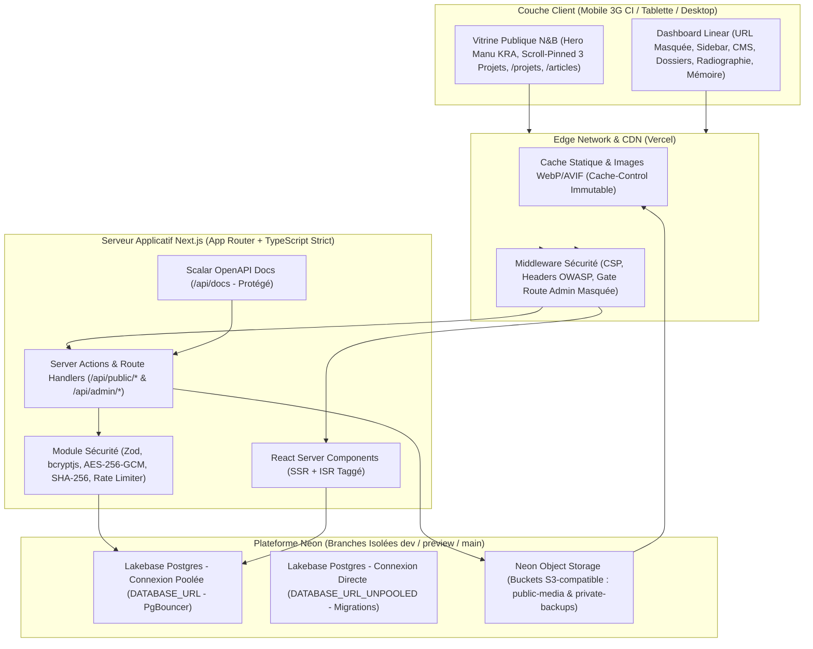

# `ARCHITECTE.md` — Architecture Système Complète

> **Modèle d'architecture :** Full-Stack Next.js App Router déployé sur Edge/Serverless (Vercel) + Backend Données & Stockage sur **Neon (Lakebase Postgres + Neon Object Storage)**.

---

## 1. Diagramme d'Architecture Globale

---

## 2. Séparation Front-End / Back-End & Flux de Données

### 2.1 Rendu Hybride Optimisé 3G
- **Pages Publiques (`/`, `/projets`, `/projets/[slug]`, `/articles`, `/articles/[slug]`) :**
  - Rendues côté serveur (**RSC**) à partir de Postgres (via connexion poolée `-pooler`) et mises en cache avec des tags granulaires (`cms:global`, `projects:featured`, `projects:list`, `articles:list`).
  - Seuls les îlots interactifs (Scroll-Pinned controller, menu partage `...`, formulaire commentaire, carte interactive MVP 4 en lazy import) hydratent du JavaScript côté client.
- **Dashboard Admin (`/${ADMIN_ROUTE_SLUG}/*`) :**
  - Aucune indexation (`X-Robots-Tag: noindex, nofollow`).
  - Mutations via Route Handlers REST typés et/ou Server Actions validées par Zod.
  - Chaque mutation admin met à jour Postgres, génère le snapshot Mémoire *(MVP 4)* et appelle `revalidateTag(...)` pour rafraîchir instantanément la vitrine publique.

### 2.2 Stratégie de Connexion Neon (`neon-postgres`)
- **Runtime applicatif :** `DATABASE_URL` (avec suffixe `-pooler`, via `pg` + Vercel Fluid compute ou `@neondatabase/serverless`) pour supporter les rafales de connexions sans saturer Postgres.
- **Migrations Drizzle Kit :** `DATABASE_URL_UNPOOLED` (connexion directe sans PgBouncer) exclusivement dans les scripts de migration/CLI (`drizzle-kit migrate`).
- **Workflow Branch-First :** Une branche Neon dédiée par environnement (`main` production, `staging`, `dev-*` pour tester les migrations et la Radiographie d'impact sans toucher aux données réelles).

### 2.3 Stratégie de Stockage Médias (`neon-object-storage`)
- **Bucket `portfolio-public` (`public_read`) :** Images WebP/AVIF des projets, portraits, logos partenaires, vidéos MP4/WebM compressées.
- Clés versionnées par hash/UUID (`projects/<projectId>/<uuid>-w1200.webp`) : zéro problème de cache obsolète lors d'un remplacement d'image dans le CMS.
- Upload sécurisé par le Dashboard via **URL présignée S3** ou endpoint `/api/admin/media/upload` avec vérification MIME réelle (magic bytes), limite de taille, génération de miniature + LQIP base64 + empreinte `SHA-256`.

---

## 3. Architecture Modulaire & Composants Réutilisables

| Couche | Modules Clés | Responsabilité |
| :--- | :--- | :--- |
| **Design Primitives** | `Button`, `Sheet`, `DropdownMenu`, `Dialog`, `Command`, `Input`, `Badge` | Base `shadcn/ui` re-stylée Monochrome N&B avec **Phosphor Icons** uniquement |
| **Vitrine Public** | `MinimalHeader`, `AltennisHero`, `StickyProjectStage`, `FolderRail`, `ShareMenu`, `RichArticleView`, `LazyVideoPlayer`, `InteractiveProjectMap` | Expérience visiteur, scroll-driven, partage `...`, articles, carte lazy |
| **Dashboard Linear** | `LinearSidebar`, `MobileAdminNav`, `AdminCommandBar`, `ProjectForm`, `FolderManager`, `BlockArticleEditor`, `CmsSectionEditor`, `ImpactXRayDialog`, `SectionMemoryViewer` | Gestion autonome, UX clavier, upload 3G, Radiographie & Mémoire |
| **Services Métier Back** | `ProjectService`, `FolderService`, `ArticleService`, `CmsService`, `CryptoService`, `ImpactAnalyzerService`, `MemorySnapshotService`, `MediaOptimizerService` | Règles métier isolées, testables unitairement sous Vitest sans UI |

---

## 4. Scalabilité & Évolution Future
- **Ajout facile d'un second rédacteur ou multi-rôle :** La table `admin_profiles` supporte un champ `role` dès l'origine.
- **Multilingue (FR / EN) ultérieur :** Les clés `cms_sections` et `projects`/`articles` peuvent être étendues par colonne `locale` sans casser la structure des routes.
- **Neon AI Gateway (optionnel futur) :** Grâce à la structure modulaire sur Neon, des résumés automatiques d'articles ou embeddings `Lakebase Search` pourront être branchés ultérieurement si souhaité sans refonte.

