# `MCD.md` — Modèle Conceptuel de Données

> Représentation conceptuelle de toutes les entités métier du portfolio de **Manu KRA** (Communication & Économie), intégrant le CMS, les Dossiers, les Projets (actuels et à venir), les Médias (multi-photos/vidéos), les Articles & Commentaires sans compte, le Soft Delete, les Recherches sauvegardées et la Mémoire des sections.

---

## 1. Diagramme Entité-Association (`erDiagram`)

```mermaid
erDiagram
    ADMIN_PROFILES ||--o{ ADMIN_SESSIONS : "ouvre"
    ADMIN_PROFILES ||--o{ AUDIT_LOGS : "génère"
    ADMIN_PROFILES ||--o{ SECTION_MEMORY_SNAPSHOTS : "enregistre"
    ADMIN_PROFILES ||--o{ SAVED_SEARCHES : "sauvegarde"

    FOLDERS ||--o{ PROJECTS : "regroupe"
    PROJECTS ||--o{ PROJECT_MEDIA : "contient (photos & vidéos)"
    PROJECTS ||--o{ ANALYTICS_EVENTS : "mesure"

    ARTICLES ||--o{ ARTICLE_COMMENTS : "reçoit (sans compte)"
    ARTICLES ||--o{ ANALYTICS_EVENTS : "mesure"

    CMS_SECTIONS ||--o{ SECTION_MEMORY_SNAPSHOTS : "versionne"

    ADMIN_PROFILES {
        uuid id PK
        string first_name "Prénom (Manu)"
        string last_name "Nom (KRA)"
        string email UK
        text phone_encrypted "AES-256-GCM"
        text password_hash "bcrypt (cost 12)"
        timestamp deleted_at "Soft Delete"
    }

    ADMIN_SESSIONS {
        uuid id PK
        uuid admin_id FK
        string token_sha256 UK
        string ip_hash_sha256
        timestamp expires_at
    }

    FOLDERS {
        uuid id PK
        string name
        string slug UK
        text description
        int display_order
        boolean is_visible_public
        timestamp deleted_at
    }

    PROJECTS {
        uuid id PK
        uuid folder_id FK
        string title
        string slug UK
        enum status "draft | upcoming | published | archived"
        text summary
        jsonb content_blocks
        boolean is_featured_home "Plafonné à 3 actifs max"
        int featured_order
        string location_city "MVP 4 Carte"
        string location_country "MVP 4 Carte"
        float latitude "MVP 4 Carte"
        float longitude "MVP 4 Carte"
        timestamp deleted_at
    }

    PROJECT_MEDIA {
        uuid id PK
        uuid project_id FK
        enum media_type "image | video"
        string object_key "Clé Neon Object Storage"
        string poster_key "Poster léger pour vidéos 3G"
        text lqip_base64 "Aperçu flou < 1 Ko"
        string sha256_hash "Intégrité média"
        int sort_order
        timestamp deleted_at
    }

    ARTICLES {
        uuid id PK
        string title
        string slug UK
        enum status "draft | published | archived"
        jsonb blocks "H1-H4, puces, tirets, liens, citations, signature"
        int reading_minutes
        timestamp published_at
        timestamp deleted_at
    }

    ARTICLE_COMMENTS {
        uuid id PK
        uuid article_id FK
        string author_name "Visiteur sans compte"
        text author_email_encrypted "Optionnel AES-256-GCM"
        text body_sanitized
        string ip_hash_sha256 "Anti-spam"
        enum moderation_status "pending | approved | rejected"
        timestamp deleted_at
    }

    CMS_SECTIONS {
        uuid id PK
        string section_key UK "hero | header | about | socials | footer | section_titles"
        jsonb payload
        string checksum_sha256
        timestamp updated_at
    }

    SECTION_MEMORY_SNAPSHOTS {
        uuid id PK
        string entity_type "cms_section | project | article | folder"
        uuid entity_id
        string section_key
        jsonb snapshot_data
        string checksum_sha256
        int version_number
        timestamp created_at
    }

    LOGOS {
        uuid id PK
        string name
        string object_key
        string link_url
        string category "client | partner | tool"
        int display_order
        boolean is_visible
        timestamp deleted_at
    }

    SKILLS {
        uuid id PK
        string title
        text description
        int display_order
        boolean is_visible
        timestamp deleted_at
    }

    SAVED_SEARCHES {
        uuid id PK
        uuid admin_id FK
        string label
        enum target "projects | articles"
        jsonb filter_params
        timestamp created_at
    }

    ANALYTICS_EVENTS {
        uuid id PK
        enum event_type "page_view | project_view | project_share | link_copy | article_view"
        uuid target_id
        string target_slug
        string session_hash_sha256
        timestamp created_at
    }

    AUDIT_LOGS {
        uuid id PK
        uuid admin_id FK
        string action
        string entity_type
        uuid entity_id
        jsonb metadata
        string integrity_hmac
        timestamp created_at
    }
```

---

## 2. Règles d'Intégrité Conceptuelles

1. **Plafond Accueil (3 Projets Max) :** Au plus **3** enregistrements de `PROJECTS` actifs (`deleted_at IS NULL`) peuvent avoir `is_featured_home = true`.
2. **Commentaires Ouverts Sans Compte :** `ARTICLE_COMMENTS` n'a aucune clé étrangère vers une table utilisateur visiteur ; l'unicité anti-abus repose sur le hash `ip_hash_sha256` et le workflow de modération.
3. **Soft Delete Généralisé :** Les entités principales (`FOLDERS`, `PROJECTS`, `PROJECT_MEDIA`, `ARTICLES`, `ARTICLE_COMMENTS`, `LOGOS`, `SKILLS`, `ADMIN_PROFILES`) portent `deleted_at` pour permettre la mise en corbeille, la **Radiographie d'impact** (calcul des relations actives pointant vers l'entité) et la restauration.
4. **Sécurité & Confidentialité :** Aucun mot de passe en clair (`bcrypt`), aucun téléphone ou e-mail privé en clair (`AES-256-GCM`), aucune IP brute stockée (`SHA-256` salé).
5. **Mémoire des Sections :** Chaque modification d'une `CMS_SECTIONS` (ou projet/article en MVP 4) produit une ligne immuable dans `SECTION_MEMORY_SNAPSHOTS` avec numéro de version incrémental et empreinte `SHA-256`.

