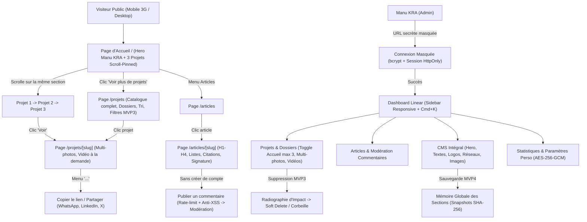
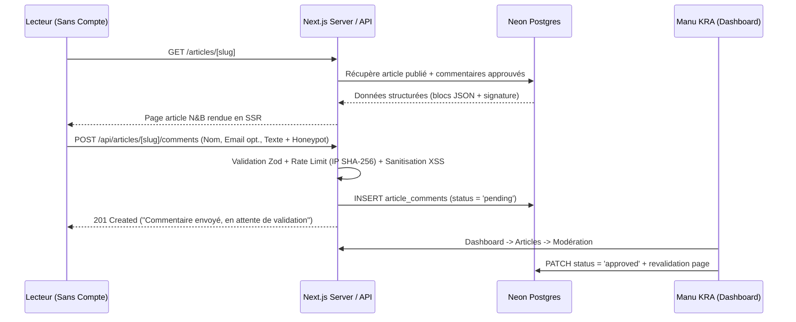
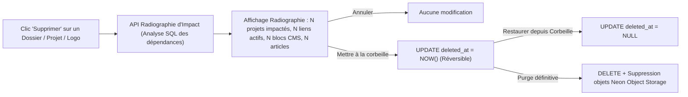

# `PRODUCT_FLOW.md` — Parcours Utilisateurs & Flux Métiers

> Description détaillée des parcours **Visiteur Public**, **Lecteur d'Article** et **Administrateur (Manu KRA)**, incluant les cas nominaux et les cas limites/réseau faible.

---

## 1. Vue d'Ensemble des Parcours (Flowchart Global)

---

## 2. Parcours 1 — Visiteur Public : Découverte Rapide & Partage (`...`)

### Séquence nominale
1. Le visiteur ouvre `/` sur smartphone en connexion 3G en Côte d'Ivoire.
2. **Rendu immédiat (SSR) :** Le Header (`MANU KRA`), le Hero ALTENNIS (titre géant, `[ COMMUNICATION & ÉCONOMIE ]`, 2 paragraphes, portrait LQIP puis WebP) s'affichent sans écran de chargement bloquant.
3. Le visiteur scrolle vers la section Projets : la section s'épingle (`sticky`) et les **3 projets phares** (max 3) défilent progressivement au rythme du scroll sans rallonger la page.
4. Sur un projet qui l'intéresse, il clique sur le bouton **`...` (trois petits points)** :
   - **Action A — Copier le lien :** Copie `https://domaine/projets/<slug>` via `navigator.clipboard.writeText` (avec fallback si navigateur ancien) et affiche « Lien copié ».
   - **Action B — Partager le lien :** Appelle `navigator.share({ title, text, url })` sur mobile ; sur desktop non compatible, ouvre une liste sobre (WhatsApp, LinkedIn, X, Email).
5. S'il veut explorer davantage, il clique sur **« Voir plus de projets »** → arrive sur `/projets`, filtre par **Dossier** ou statut (**Réalisés** / **À venir**), puis ouvre `/projets/[slug]`.
6. Sur la page projet, les **photos** chargent en lazy WebP avec blur initial, et la **vidéo** reste à l'état de poster léger tant qu'il ne clique pas sur Lecture.

### Cas d'échec & dégradation
- **Connexion coupée / très lente :** Le texte complet du projet reste lisible instantanément ; les images affichent le placeholder monochrome LQIP ; bouton « Réessayer » sur la vidéo si timeout.
- **Lien partagé vers un projet archivé ou inexistant :** Page 404 minimaliste avec retour direct vers `/projets`.

---

## 3. Parcours 2 — Lecteur : Articles & Commentaires Sans Compte

---

## 4. Parcours 3 — Admin Masqué (Manu KRA) : Dashboard Linear & Publication Accueil

1. **Accès secret :** Manu KRA saisit directement l'URL cachée (ex. `/acces-studio-kra` configurée dans `.env`). Aucun bouton sur le site ne mène à cette URL. Une mauvaise route renvoie `404`.
2. **Authentification :** Saisie email/identifiant + mot de passe. Vérification `bcryptjs` + rate limit anti-bruteforce (5 tentatives / 15 min). Création session en DB (`SHA-256` du token) + cookie `HttpOnly`.
3. **Gestion Projets & Plafond Accueil (Max 3) :**
   - Manu crée un dossier *« Études Économiques »* dans l'onglet **Dossiers**.
   - Il crée un projet *« Indice des Prix Abidjan 2026 »* (statut `À venir` ou `Réalisé`), importe 4 photos (compressées automatiquement en WebP + LQIP) et 1 vidéo (avec poster).
   - Il active le switch **« Publier sur l'accueil »**. Si 3 projets sont déjà épinglés sur l'accueil, une modale Linear lui demande lequel remplacer (garantissant toujours `≤ 3` projets sur l'accueil).
4. **Édition CMS Intégrale :**
   - Dans l'onglet **CMS Site**, il modifie le titre du Hero, un logo partenaire ou un lien LinkedIn.
   - Sauvegarde en base → snapshot automatique dans la **Mémoire des Sections** *(MVP 4)* → `revalidatePath('/')` rend le changement instantané en public.

---

## 5. Parcours 4 — Soft Delete & Radiographie d'Impact *(MVP 3)*

