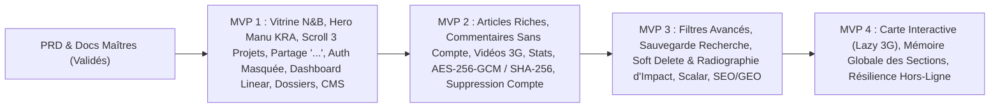

# `ROADMAP.md` — Plan de Bataille (PRD → MVP → Versions)

> **Logique adaptée au contexte Côte d'Ivoire :** Mettre en ligne rapidement une vitrine **ultra-légère, belle et autonome** dès le **MVP 1**, puis ajouter progressivement l'éditorial riche, les fonctionnalités d'analyse et l'exploration géographique sans jamais dégrader la vitesse sur réseau 3G.

---

## 1. Vue d'Ensemble de la Progression (`PRD → MVP 1 → MVP 4`)

---

## 2. Règle d'Exécution Feature par Feature

Pour chaque MVP, le développement suit un cycle strict à 5 étapes par micro-tâche :
1. **Spécification** : Relire la fiche du module (`MVP_X.md`, `PRD.md`, `DB_SCHEMA.md`).
2. **Code Front & Back typé** : Zéro `any`, validation Zod, icônes Phosphor uniquement, mobile-first.
3. **Test de la Feature** : Exécution des scénarios `OK / KO / NA` (unitaires Vitest + vérification UI 390px / 768px / 1440px).
4. **Commit & Mémoire** : Commit Conventional Commits + mise à jour `MEMORY/02_STRUCTURED_BRAIN/INDEX.md` et `MVP_X.md`.
5. **Passage à la feature suivante** uniquement quand tous les tests précédents sont au vert.

---

## 3. Périmètre Détaillé par Version

### MVP 1 — Socle Minimaliste & Autonomie CMS *(Priorité Absolue)*
- **Objectif CI :** Pouvoir partager dès la fin du MVP 1 un portfolio rapide sur mobile 3G avec le Hero de Manu KRA, les 3 projets phares au scroll, les dossiers et un Dashboard Linear pour tout modifier.
- **Modules :**
  - `M1.1` Initialisation Next.js + TS Strict (`no-explicit-any`) + Tailwind + shadcn/ui (Phosphor Icons) + Neon Drizzle.
  - `M1.2` Auth Masquée (`bcrypt` + cookie `HttpOnly` + route secrète).
  - `M1.3` Dashboard Linear Shell (Sidebar responsive + `Cmd+K`) & Paramètres Profil (Nom, Prénom, Email, Mot de passe).
  - `M1.4` CMS Global (Hero ALTENNIS, Header, À propos, Compétences, Logos, Réseaux sociaux, Titres de sections).
  - `M1.5` Dossiers & Projets CRUD (Statut Réalisé/À venir, Multi-photos WebP sur Neon Object Storage, Toggle Accueil plafonné à 3).
  - `M1.6` Vitrine Publique N&B (Hero Manu KRA, Section Scroll-Pinned max 3 projets, Section Dossiers/Compétences/Logos, Catalogue `/projets`, Détail `/projets/[slug]`, Menu `...` Copier/Partager).
- **Détail micro-tâches :** [MVP_1.md](./MVP_1.md)

### MVP 2 — Éditorial, Vidéos 3G, Statistiques & Cryptographie Complète
- **Objectif :** Publier les articles économiques/communication, intégrer les vidéos sans alourdir la 3G, activer le chiffrement complet des données personnelles et les statistiques réelles.
- **Modules :**
  - `M2.1` Chiffrement `AES-256-GCM` (téléphone, e-mails privés) + Hachage `SHA-256` & `HMAC` + Suppression de compte sécurisée.
  - `M2.2` Lecteur & Upload Vidéos optimisés 3G (poster WebP + `preload="none"`).
  - `M2.3` Éditeur & Rendu d'Articles riches (H1–H4, listes à puces, tirets, liens, citations, signature).
  - `M2.4` Commentaires d'Articles **sans création de compte** + Modération Dashboard + Anti-spam.
  - `M2.5` Dashboard Statistiques réelles & Corbeille Soft Delete de base.
- **Détail micro-tâches :** [MVP_2.md](./MVP_2.md)

### MVP 3 — Recherche Avancée, Radiographie d'Impact, Scalar & GEO
- **Objectif :** Industrialiser la découverte de projets, sécuriser les suppressions par analyse d'impact, et maximiser le référencement SEO/GEO.
- **Modules :**
  - `M3.1` Filtres avancés multi-critères (`/projets` et `/articles`).
  - `M3.2` Sauvegarde de recherches (Dashboard & favoris URL visiteur).
  - `M3.3` Soft Delete complet & **Radiographie d'Impact** (graphe des dépendances avant mise en corbeille ou purge).
  - `M3.4` Documentation interactive **Scalar** (`/api/docs`) + SEO/GEO avancé (`llms.txt`, JSON-LD, OpenGraph dynamique).
- **Détail micro-tâches :** [MVP_3.md](./MVP_3.md)

### MVP 4 — Carte Interactive, Mémoire Globale des Sections & Résilience 3G
- **Objectif :** Ajouter la dimension géographique et une machine à remonter le temps sur toutes les sections du portfolio.
- **Modules :**
  - `M4.1` **Carte interactive** des projets (Côte d'Ivoire & International, lazy-loaded 3G).
  - `M4.2` **Mémoire globale des sections** (snapshots automatiques CMS/Projets/Articles avec diff & restauration).
  - `M4.3` Résilience réseau faible avancée (brouillons locaux auto-sync, cache offline léger).
- **Détail micro-tâches :** [MVP_4.md](./MVP_4.md)

